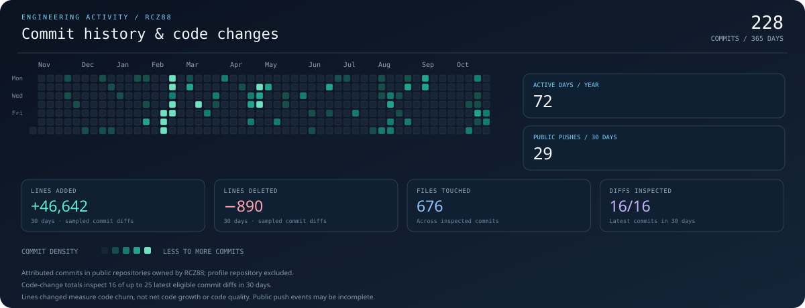

  

  
<strong>Algorithms &nbsp;·&nbsp; Systems Programming &nbsp;·&nbsp; Neural Networks</strong>

  
I like understanding what happens beneath the abstractions, then building things with that understanding.

  

    <a href="#featured-work">FEATURED WORK</a> &nbsp;·&nbsp;
    <a href="#engineering-activity">ENGINEERING ACTIVITY</a> &nbsp;·&nbsp;
    <a href="https://github.com/RCZ88?tab=repositories">ALL REPOSITORIES</a>
  

  

    
    
    
  

---

## What I'm exploring

<table>
  <tr>
    <td width="50%" valign="top">
      <h3>01 / Algorithms & data structures</h3>
      Understanding time and space complexity, implementing data structures, and learning why an algorithm works instead of only memorising a solution.
    </td>
    <td width="50%" valign="top">
      <h3>02 / C & memory</h3>
      Pointers, allocation, ownership, resizing, failure handling, and designing useful abstractions without hiding the underlying mechanics.
    </td>
  </tr>
  <tr>
    <td width="50%" valign="top">
      <h3>03 / Neural networks</h3>
      Returning to the maths behind learning systems: forward propagation, backpropagation, attention, and small models I can reason about from first principles.
    </td>
    <td width="50%" valign="top">
      <h3>04 / AI infrastructure</h3>
      MCP servers, agent skills, context management, tool workflows, and ways to test AI-driven systems instead of trusting them blindly.
    </td>
  </tr>
</table>

## Featured work

These projects show the problems I'm interested in, from implementing algorithms to building the infrastructure around AI-powered applications.

<table>
  <tr>
    <td width="50%" valign="top">
      

      <h3><a href="https://github.com/RCZ88/SVMxRF-BC">SVM vs. Random Forest</a></h3>
      
A from-scratch comparison on the Wisconsin Breast Cancer dataset. The goal was to understand the algorithms, not just call a prebuilt estimator.

      
<code>Python</code> <code>NumPy</code> <code>Optimisation</code>

      

        
Technical details

        <ul>
          <li>Custom SVM using the dual formulation and a quadratic-programming solver.</li>
          <li>Random Forest with recursive tree splitting, Gini impurity, bootstrapping, and feature subsampling.</li>
          <li>Stratified cross-validation and evaluation with precision, recall, and F1.</li>
        </ul>
      

    </td>
    <td width="50%" valign="top">
      

      <h3>SALOK / Smart Memory Allocation</h3>
      
An experimental C library that grew out of a dynamic-array problem in a Blackjack project. I'm using it to explore memory management and reusable data structures, while the API and architecture are still being shaped by the problems I encounter.

      
<code>C</code> <code>Allocation</code> <code>Dynamic arrays</code>

      

        
What I'm working through

        <ul>
          <li>Clear ownership and allocation lifetime rules.</li>
          <li>Safe resizing and allocation-failure behaviour.</li>
          <li>Typed interfaces versus a generic internal implementation.</li>
          <li>Keeping allocation tracking separate from containers unless combining them has a clear benefit.</li>
        </ul>
        
<em>SALOK is unfinished and not presented as a released library. Its current development work is not yet published as a finished implementation.</em>

      

    </td>
  </tr>
  <tr>
    <td width="50%" valign="top">
      

      <h3><a href="https://github.com/RCZ88/neuroquant">NeuroQuant</a></h3>
      
An experimental quantitative modelling project exploring how model outputs and market signals can be combined under uncertainty.

      
<code>Python</code> <code>LSTM</code> <code>Attention</code>

      

        
Technical direction

        
The repository describes LSTM-based prediction, attention, sentiment analysis, Bayesian signal fusion, and market-regime detection. These are project design claims, not a guarantee that every part is fully realised in the current version.

      

    </td>
    <td width="50%" valign="top">
      

      <h3><a href="https://github.com/RCZ88/RHEO">RHEO</a></h3>
      
A large desktop application exploring local activity tracking, persistent state, terminal workflows, and AI-agent orchestration.

      
<code>Electron</code> <code>React</code> <code>TypeScript</code> <code>SQLite</code>

      

        
Engineering focus

        
Connecting desktop UI, local data, terminal sessions, and agent workflows into an application with multiple interacting subsystems.

      

    </td>
  </tr>
  <tr>
    <td width="50%" valign="top">
      

      <h3><a href="https://github.com/RCZ88/mcp-ai-bridge">MCP-AI Bridge</a></h3>
      
A service for connecting AI agents to external tools through the Model Context Protocol, with request-scoped sessions and server-side credential handling.

      
<code>Python</code> <code>FastAPI</code> <code>MCP</code>

    </td>
    <td width="50%" valign="top">
      

      <h3><a href="https://github.com/RCZ88/ecosystem">Agent ecosystem</a></h3>
      
A file-based approach to coordinating agent state, reusable skills, context, and structured actions without introducing a large runtime.

      
<code>JavaScript</code> <code>Automation</code> <code>Context design</code>

    </td>
  </tr>
</table>

## Tools, apps & environments I use

  
  
  
  
  
  
  
  
  
  
  
  
  
  
  
  
  
  
  
  
  

## Engineering activity

  

Activity covers commits attributed to @RCZ88 in public repositories owned by @RCZ88, excluding this profile repository. The chart separates the 365-day commit history from code-change statistics, and the underlying project activity is not a complete representation of every experiment or private contribution.

---

  Still learning the fundamentals. Still building things that use them.

