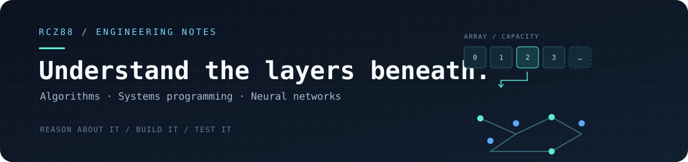

  
  
<strong>Algorithms · Systems Programming · Neural Networks</strong>

  
Learning how things work underneath the abstractions, then building with that understanding.

  

    <a href="https://github.com/RCZ88?tab=repositories">Repositories</a>
    · <a href="https://github.com/RCZ88">GitHub</a>
    · <a href="mailto:clementzhao74@gmail.com">Email</a>
    · <a href="https://instagram.com/rclement_z">Instagram</a>
  

---

## Current focus

- **Algorithms and data structures.** Practising problem solving, complexity analysis, and implementing reusable structures rather than only relying on library implementations.
- **C and memory management.** Exploring allocation, ownership, resizing, and the design of small, reusable systems interfaces through SALOK.
- **Neural networks.** Revisiting the mathematics behind learning systems, with particular interest in backpropagation, attention, and transformer architectures.
- **AI infrastructure.** Building with MCP, agent workflows, context management, and tools that can test and improve their own workflows.

## Selected work

### [SVM vs. Random Forest](https://github.com/RCZ88/SVMxRF-BC)

A from-scratch comparison of Support Vector Machines and Random Forests on the Wisconsin Breast Cancer dataset. The project explores the SVM dual optimisation problem, tree splitting, bootstrapping, cross-validation, and the trade-offs between precision and recall. The SVM quadratic programme uses CVXOPT rather than a scikit-learn estimator.

**Focus:** algorithms · optimisation · evaluation · Python

### SALOK · Smart Memory Allocation `IN PROGRESS`

An experimental C library that grew out of a practical need for a dynamically resizing array while building a Blackjack game. The project is an opportunity to explore allocation and reallocation, explicit ownership, allocation failure handling, typed interfaces, and reusable data structures. Its API and architecture are still being worked out; it is not a finished library.

**Focus:** C · memory management · dynamic arrays · API design

### [NeuroQuant](https://github.com/RCZ88/neuroquant)

An experimental quantitative research platform exploring LSTM models, attention, sentiment signals, Bayesian fusion, and market-regime detection. It connects model design with the challenge of combining noisy signals and evaluating decisions under uncertainty.

**Focus:** neural networks · machine learning · quantitative modelling

### [MCP-AI Bridge](https://github.com/RCZ88/mcp-ai-bridge)

A stateless FastAPI service for connecting AI agents to external tools through the Model Context Protocol. The design explores request-scoped tool sessions, server-side credential handling, and auditing tool calls.

**Focus:** Python · FastAPI · MCP · agent infrastructure

### [RHEO](https://github.com/RCZ88/RHEO)

A desktop application in active development, built with Electron, React, TypeScript, and SQLite. Its scope includes local activity tracking and AI-agent workflows, with an emphasis on connecting application architecture, persistent state, and tooling.

**Focus:** Electron · TypeScript · React · SQLite · AI orchestration

### [Agent ecosystem](https://github.com/RCZ88/ecosystem)

A file-based framework for sharing state, durable notes, actions, and reusable skills across AI agents. It explores how a simple set of explicit files and scripts can coordinate agents without requiring a large runtime dependency stack.

**Focus:** agent workflows · context management · automation

## Technologies

**Languages**

**Application and data**

**AI and development tools**

## Commit activity

  

The chart counts commits attributed to @RCZ88 in public repositories owned by @RCZ88 over the last 365 days. It excludes this profile repository to avoid counting its own generated updates. Public push events are shown separately for the last 30 days and are subject to GitHub's event-history limits. Private repositories and repositories owned by other accounts are not included.

---

  Built around the work, not the widgets.

